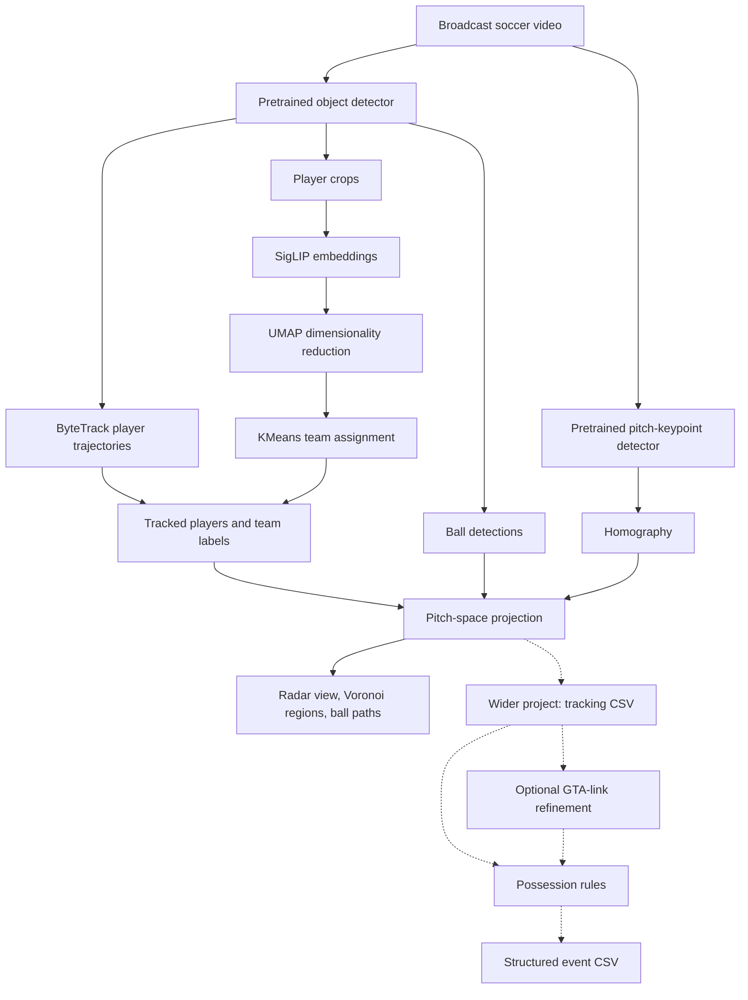

# Soccer Analytics: From Match Video to Structured Events

**Computer vision, multi-object tracking, team clustering, and pitch-space analysis for soccer video.**

[](https://colab.research.google.com/github/Bilolini/cse327/blob/main/notebooks/football-ai.ipynb)
[](notebooks/football-ai.ipynb)
[](https://pytorch.org/)
[](notebooks/football-ai.ipynb)

Broadcast footage contains much more than a scoreline. This project explores how to recover player identities, team membership, ball movement, and spatial structure from match video, then use tracking data to reason about soccer events.

Developed as a CSE327 project at **SUNY Korea**, the work connects pretrained vision models with geometric projection and interpretable event rules. Its main engineering focus is making these components work together: handling fragmented player IDs, unreliable ball detections, mismatched pitch keypoints, and incompatible tracking-data formats.

> **Start here:** [Football analysis notebook](notebooks/football-ai.ipynb) · [Event generator](TrackingDataToEventData/generate_event_data.py) · [Saved evaluation results](evaluation/benchmark_comparison_summary_10000.csv)

The repository includes the vision notebook, tracking-format converters, the adapted event-generation code and its analysis dependency, and saved evaluation summaries. GTA-link itself, pretrained weights, match footage, and full tracking datasets are obtained separately.

## At a Glance

| Component | Approach |
| --- | --- |
| Object detection | Pretrained football-specific Roboflow detector |
| Player tracking | ByteTrack through Supervision |
| Team assignment | SigLIP image embeddings → UMAP → KMeans |
| Goalkeeper assignment | Distance to each team's player centroid |
| Camera calibration | Pitch-keypoint detection and planar homography |
| Spatial analysis | Bird's-eye radar, Voronoi regions, and ball trajectories |
| Wider project | Optional GTA-link refinement and possession-based event generation |

## How It Works



Solid connections describe the vision notebook. Dashed connections show the tracking-to-event workflow implemented by the conversion and event-generation scripts; GTA-link is an optional external dependency.

### 1. Detect and Track

The detector identifies the ball, goalkeepers, players, and referees. Non-maximum suppression removes redundant boxes, and ByteTrack associates non-ball detections across frames.

The resulting IDs identify trajectories. Occlusion and re-entry can still create new IDs for the same player, which motivated the separate tracklet-refinement experiments.

### 2. Assign Teams with Visual Embeddings

Team assignment uses the visual appearance of player crops:

1. Sample frames and extract player crops.
2. Encode crops with pretrained `google/siglip-base-patch16-224`.
3. Reduce the 768-dimensional embeddings to three dimensions with UMAP.
4. Fit KMeans with two clusters.
5. Predict team labels for new crops using Roboflow Sports' `TeamClassifier`.

The notebook includes an interactive Plotly embedding view for inspecting the crop associated with each point. Goalkeepers are assigned using team centroids because their uniforms differ from those of outfield players.

Cluster labels are arbitrary: cluster 0 does not automatically mean the home team. A home/away mapping needs to be checked before downstream analysis.

### 3. Project the Match onto the Pitch

A second pretrained model detects field landmarks. Confident image points are paired with reference pitch coordinates to estimate a homography. Player bottom-center anchors and ball detections can then be mapped onto a shared pitch plane.

This supports four complementary views:

- Broadcast-frame detections with tracker IDs and team colors.
- A top-down radar showing player, referee, and ball positions.
- Voronoi regions based on proximity to the two teams.
- A blended spatial view with projected positions overlaid.

Voronoi regions describe geometric proximity, rather than a validated probability of ball control.

### 4. Inspect Ball Movement

The published notebook projects ball detections across frames, averages a short history of homography matrices, removes ambiguous frames with multiple ball candidates, and filters implausible jumps by distance.

The wider project also explored a dedicated ball detector with sliced inference and temporal candidate selection. This addresses a central challenge: a small, fast-moving ball can disappear when an entire broadcast frame is resized for detection.

### 5. Derive Events from Tracking Data

Tracking rows are converted into separate Metrica-style home/away files. An optional path converted player boxes to MOT format, extracted appearance features, refined identities with GTA-link, and converted the results back.

A rule-based event generator used player-ball proximity and possession transitions:

| Tracking condition | Event interpretation |
| --- | --- |
| Ball is close enough to the nearest player | Candidate possession |
| Possession moves between teammates | Pass |
| Possession changes teams | Ball lost and recovery |
| Ball crosses the pitch boundary | Ball out |
| Play resumes from a recognized restart region | Set piece |

This design makes decisions inspectable: an event can be traced back to a possession transition and the underlying coordinates.

## Engineering Work and Findings

The project builds on Roboflow's open-source football notebook and sports utilities. The broader integration work focused on:

- **Data interoperability:** connecting long-form tracking CSVs, MOT bounding boxes, and Metrica-style tracking files.
- **Identity continuity:** comparing raw ByteTrack IDs with offline GTA-link refinement.
- **Ball reliability:** investigating missed detections, trajectory jumps, and the impact of missing coordinates on possession.
- **Calibration debugging:** examining keypoint-count mismatches and why landmark correspondence matters more than matching array lengths.
- **Downstream evaluation:** comparing event outputs with and without identity refinement.

A key development finding was that improved identity continuity did not consistently improve event detection. Possession rules also depend strongly on ball continuity and calibration quality. This motivated treating tracking quality and event quality as separate evaluation problems.

## Evaluation

The archived evaluation summaries are included in [`evaluation/`](evaluation/). These are saved development results, rather than a newly executed benchmark.

### Event Generation on Reference Tracking Data

The generator was evaluated over the first **10,000 frames** of each of two Metrica sample games. A strict match required the same event type, the same team, and a start frame within **±25 frames**.

| Sample game | Reference events in window | Generated events | Matched events | Precision | Recall | F1 |
| --- | ---: | ---: | ---: | ---: | ---: | ---: |
| 1 | 138 | 116 | 95 | 0.819 | 0.6884 | 0.748 |
| 2 | 167 | 148 | 129 | 0.8716 | 0.7725 | 0.819 |

[Source summary](evaluation/benchmark_comparison_summary_10000.csv)

These results evaluate the event stage using reference tracking data. They do **not** measure end-to-end accuracy from broadcast video. The original matching script and complete benchmark inputs are not bundled, so the saved summary alone is insufficient to reproduce the evaluation.

### Does Identity Refinement Change Events?

| Tracking source | Events with GTA-link | Events without GTA-link | Shared events, ignoring player IDs |
| --- | ---: | ---: | ---: |
| `121364_0.csv` | 4 | 4 | 4 |
| `121364_2.csv` | 26 | 27 | 19 |

[Source summary](evaluation/tracklets_vs_raw_event_detection_summary.csv)

Event counts are descriptive, not an accuracy metric. This comparison shows why reducing fragmented IDs should be evaluated separately from recognizing the correct events.

## Run the Notebook

The notebook is organized for **Google Colab with a GPU runtime**.

1. Click **Open in Colab** above.
2. Select a GPU runtime.
3. Add `HF_TOKEN` and `ROBOFLOW_API_KEY` in Colab's **Secrets** panel and grant the notebook access.
4. Run the dependency-installation cells.
5. Download a sample clip using the notebook's download cells, or upload your own video.
6. Set `SOURCE_VIDEO_PATH` to the clip's location.
7. Run the sections in order: detection, tracking, team clustering, calibration, spatial visualization, and ball-path analysis.

The notebook currently references these pretrained Roboflow model versions:

| Task | Model ID |
| --- | --- |
| Player/object detection | `football-players-detection-3zvbc/11` |
| Pitch keypoints | `football-field-detection-f07vi/14` |

Model access requires your own credentials. No model training from scratch is required; UMAP and KMeans are fitted to crops from the selected clip.

### Runtime Notes

- The notebook uses `google.colab.userdata` and `/content/` paths, so Colab is the intended starting environment.
- GPU execution is explicitly requested in parts of the notebook.
- Install cells pull external packages, including Roboflow Sports, without a fully pinned environment. Changes to Supervision or model-response APIs may require adjustments.
- Pitch projection requires at least four suitable landmark correspondences. The published notebook contains count-based padding in some calibration cells; verify the model's landmark ordering against the pitch configuration before relying on projected coordinates.
- Full-video processing can take substantial time, especially during embedding extraction. Use a short clip for the first run.

## Run Tracking-to-Event Conversion

Use **Python 3.12 or newer** for the event scripts: some existing f-strings use syntax introduced in Python 3.12.

```bash
git clone https://github.com/Bilolini/cse327.git
cd cse327
python3 -m venv .venv
source .venv/bin/activate
python -m pip install -r TrackingDataToEventData/FootballMatchAnalysis/requirements.txt
```

Convert a long tracking CSV to home/away files:

```bash
python TrackingDataToEventData/csv_converter.py \
  --input-csv /path/to/tracking.csv \
  --outdir TrackingDataToEventData/data/Sample_Game_12 \
  --game-id 12
```

The converter expects the ten-column tracking schema below. It normalizes pitch coordinates using a 12000 × 7000 configuration, assigns each raw ID to its majority team, and keeps the 14 most frequent IDs per team by default. Adjust `--max-players-per-team` when needed; these are preprocessing choices, not identity guarantees.

```text
Frame, Object, Object ID, Team,
X1, Y1, X2, Y2, X_Pitch, Y_Pitch
```

In [`generate_event_data.py`](TrackingDataToEventData/generate_event_data.py), set `game_id`, `start_frame`, `end_frame`, and `fps` for your input. Leave `generate_video = False` and `print_frames = False` for a CSV-only run.

```bash
cd TrackingDataToEventData
python generate_event_data.py
```

The default event configuration targets sample game 2 and frames 1–10000; configure it before running against your own converted data. Generated event files are saved in the selected game's data directory.

### Optional MOT / GTA-link Route

```bash
# From the repository root:
python tracking_csv_to_mot.py /path/to/tracking.csv \
  --sequence my_clip \
  --output-dir mot_data/pred
```

This writes separate `all/`, `home/`, and `away/` MOT files. Extract **raw, unannotated frames** from the same clip for GTA-link's appearance-feature stage, preserving frame alignment.

Install [GTA-link](https://github.com/sjc042/gta-link) separately and follow its checkpoint and tracklet-generation instructions. [`build_sample_game_7_from_gta.py`](build_sample_game_7_from_gta.py) is the project's reference conversion script for mapping refined MOT identities back to pitch-space tracking while retaining ball coordinates from the original CSV. Its paths and game settings are experiment-specific and must be edited for a new sequence.

## Repository

```text
.
├── notebooks/football-ai.ipynb       # Vision, clustering, calibration, spatial views
├── TrackingDataToEventData/
│   ├── csv_converter.py             # Raw CSV → Metrica-style home/away files
│   ├── generate_event_data.py       # Possession and event generation
│   ├── parse_possessions.py         # Event decisions from possession segments
│   ├── utils/                      # Event records and geometric helpers
│   └── FootballMatchAnalysis/       # Bundled analysis dependency + upstream license
├── tracking_csv_to_mot.py           # Raw player boxes → per-team MOT files
├── build_sample_game_7_from_gta.py  # Reference refined-ID conversion
├── evaluation/                     # Saved benchmark and ablation summaries
└── THIRD_PARTY.md                   # Attribution and reuse notes
```

The notebook has no saved execution outputs. Match footage, pretrained weights, full tracking files, virtual environments, and generated videos are excluded.

## Limitations

- Position-only tracking does not capture body pose, foot orientation, or player intent.
- Occlusion, missed detections, and ID switches affect trajectory continuity.
- A planar homography does not recover ball height; aerial passes and bounces can produce misleading pitch-space paths.
- Team clustering depends on crop quality and visual differences between uniforms.
- Tracking positions require additional rules or learned models to become semantic events.
- Synchronized public video, tracking, and event datasets remain limited.

## Built With

**Python · PyTorch · Roboflow Inference · Supervision · Roboflow Sports · Hugging Face Transformers · SigLIP · UMAP · scikit-learn · NumPy · OpenCV · Plotly**

## Credits and References

The notebook is adapted from Roboflow's football-analysis tutorial. Pretrained models, tracking algorithms, and foundation models retain their original authorship. The project contribution is their adaptation, integration, debugging, and investigation for soccer analytics.

- [Roboflow Sports](https://github.com/roboflow/sports) — team classification, pitch geometry, projection, and visualization utilities.
- [ByteTrack](https://github.com/ifzhang/ByteTrack) — multi-object tracking.
- [SigLIP](https://huggingface.co/google/siglip-base-patch16-224) — pretrained visual representations.
- [Roboflow camera-calibration tutorial](https://blog.roboflow.com/camera-calibration-sports-computer-vision/) — football pitch calibration and notebook foundation.
- [Roboflow ball-tracking tutorial](https://blog.roboflow.com/tracking-ball-sports-computer-vision/) — small-ball detection and sliced-inference reference.
- [GTA-link](https://github.com/sjc042/gta-link) — offline tracklet association used in the wider project.
- [FootballTrackingDataGeneration](https://github.com/JohnComonitski/FootballTrackingDataGeneration) and [TrackingDataToEventData](https://github.com/JohnComonitski/TrackingDataToEventData) — wider tracking-to-event workflow foundations.
- [FootballMatchAnalysis](https://github.com/JohnComonitski/FootballMatchAnalysis) — bundled analysis dependency; original MIT license retained.
- [LaurieOnTracking](https://github.com/Friends-of-Tracking-Data-FoTD/LaurieOnTracking) — Metrica IO, visualization, and pitch-control routines used by the analysis dependency.
- [Metrica Sports sample data](https://github.com/metrica-sports/sample-data) — reference tracking/event formats and benchmark data.
- [SoccerNet Ball Action Spotting](https://www.soccer-net.org/tasks/ball-action-spotting) and [FOOTPASS](https://github.com/JeremieOchin/FOOTPASS) — related soccer action-spotting work.

Consult upstream licenses and dataset terms before reusing third-party code, pretrained weights, or match footage.

## Author

**[Bilol Meliboev](https://github.com/Bilolini)**  
SUNY Korea · Computer Science  
[bilol.meliboev@stonybrook.edu](mailto:bilol.meliboev@stonybrook.edu)

